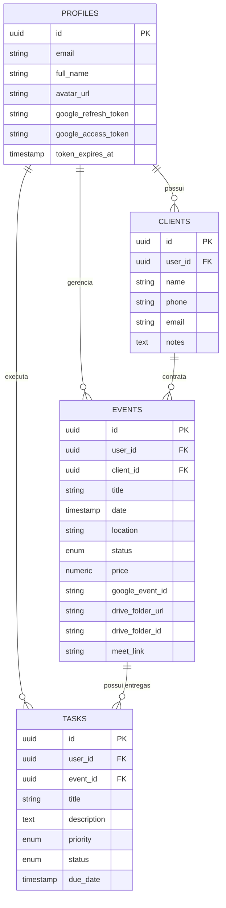

<div align="center">


# OrganizaAry 📸🎬

### *Gestão inteligente de captações, clientes e pós-produção audiovisual*
**Desenvolvido para a rotina dinâmica de fotógrafos, videomakers e produtoras.**

[](https://nextjs.org/)
[](https://react.dev/)
[](https://www.typescriptlang.org/)
[](https://tailwindcss.com/)
[](https://supabase.com/)
[](https://cloud.google.com/)

</div>

---

## 📌 Visão Geral

O **OrganizaAry** é uma plataforma web *mobile-first* com design cinematográfico criada para unificar o fluxo de trabalho de ponta a ponta de fotógrafos e produtoras audiovisuais (**EAREC Produtora Audiovisual**). 

Eliminando a dispersão entre planilhas soltas, anotações de celular e conversas perdidas no chat, a aplicação centraliza:
- **CRM de Clientes** com histórico 360º e contato rápido via WhatsApp;
- **Agenda de Trabalhos & Ensaios** com máquina de estados de produção e controle financeiro;
- **Fila de Edição & Pós-Produção** com prioridades, prazos e conclusão automatizada;
- **Integração Silenciosa com Google Workspace** (pastas no Drive, eventos na Agenda e links do Meet criados no piloto automático).

---

## ✨ Principais Funcionalidades

### 1. 📊 Dashboard Operacional em Tempo Real
- **Métricas Chave**: Visualização imediata do faturamento acumulado, total de captações do mês, edições pendentes e clientes na base.
- **Próximos Trabalhos**: Lista rápida das próximas diárias com data, horário, local e links diretos (Google Drive e WhatsApp).
- **Fila de Edição Imediata**: Checklist das edições que faltam entregar, com controle de status direto no painel.
- **Ações Rápidas**: Modais simplificados para adicionar novos trabalhos, tarefas e clientes em segundos.

### 2. 🎬 Gestão Unificada de Trabalhos & Ensaios (`/events`)
- **Ciclo de Vida Completo**: Máquina de 5 estados para cada captação:
  1. `Orçamento (Lead)`
  2. `Agendado`
  3. `Captado`
  4. `Pós-Produção`
  5. `Finalizado`
- **Controle Financeiro por Job**: Definição de valor bruto do contrato e acompanhamento da receita.
- **Visão Dual Intuitiva**:
  - **Aba Agenda**: Cronograma detalhado de ensaios, locais e horários.
  - **Aba Edição**: Fila focada nas entregas pendentes daquele evento.

### 3. 💬 WhatsApp em 1 Toque & CRM 360º (`/clients`)
- **Conversa Imediata**: Inicie o atendimento no WhatsApp Web/App com apenas 1 clique, sem a necessidade de salvar o número na agenda do telefone.
- **Visão 360º do Cliente**: Detalhamento com histórico de todas as captações já realizadas, faturamento total gerado pelo cliente e notas internas de briefing.

### 4. ✂️ Fila de Edição & Pós-Produção
- **Checklist com Níveis de Prioridade**: Classificação ágil entre *Baixa*, *Média*, *Alta* e *Urgente*.
- **Controle de Prazos (Deadlines)**: Alerta visual para edições próximas do vencimento ou atrasadas.
- **Automação Inteligente**: Ao marcar um trabalho como **Finalizado**, todas as tarefas de edição pendentes associadas a ele são automaticamente concluídas.

### 5. ⚡ Automações com o Ecossistema Google (OAuth 2.0)
- 📁 **Google Drive**: Criação automática da hierarquia oficial de pastas na nuvem:
  ```text
  [AAAA/MM] - [Nome do Cliente] - [Nome do Evento]
  ├── RAWs
  └── Entregas
  ```
- 🗓️ **Google Calendar**: Agendamento sincronizado do ensaio com data, horário, local e descrição na agenda do profissional.
- 🎥 **Google Meet**: Geração dinâmica de salas virtuais com 1 toque para reuniões de alinhamento e briefing com clientes.
- 🔄 **Auto-Refresh Offline**: Captura de `refresh_token` durante o login SSO do Google, permitindo que as automações rodem de forma contínua em segundo plano sem expirar a sessão.

### 6. 📖 Guia do Usuário Integrado
- Tutorial interativo e reconsultável a qualquer momento através do botão **"Guia de Uso"** na barra de navegação, orientando sobre os fluxos operacionais e melhores práticas do estúdio.

---

## 🎨 Design System & Identidade Visual

O OrganizaAry adota uma estética minimalista e cinematográfica, desenvolvida sob medida para criadores visuais:

- **Paleta Dark & Quente**: Fundo principal `#121110`, cartões em `#161513` e bordas elegantes em `#23201c`.
- **Acentos Dourados & Champagne**: Detalhes e focos de atenção em `#c8a97e` e `#dfba88`, remetendo à sofisticação e qualidade das produções EAREC.
- **Tipografia Moderna**: Geist Sans e Geist Mono com escala tipográfica legível e espaçamentos equilibrados.
- **Mobile-First & PWA-ready**: Projetado para uso fluido tanto em smartphones no meio de uma captação quanto em desktops de edição.

---

## 🛠️ Stack Tecnológica

| Camada | Tecnologia | Descrição |
| :--- | :--- | :--- |
| **Framework Web** | [Next.js 16](https://nextjs.org/) (App Router) | Renderização híbrida (RSC & Server Actions) |
| **Biblioteca UI** | [React 19](https://react.dev/) | Componentização reativa de última geração |
| **Linguagem** | [TypeScript](https://www.typescriptlang.org/) | Tipagem estrita de ponta a ponta |
| **Estilização** | [Tailwind CSS v4](https://tailwindcss.com/) | Estilização utilitária de alta performance |
| **Animações** | [Framer Motion](https://www.framer.com/motion/) | Transições suaves entre abas, modais e listas |
| **Ícones** | [Lucide React](https://lucide.dev/) | Conjunto consistente de ícones vetoriais |
| **Banco de Dados** | [Supabase](https://supabase.com/) (PostgreSQL) | Banco relacional com RLS e auth integrado |
| **Autenticação** | Supabase Auth + Google OAuth 2.0 | Login unificado com solicitação de escopos offline |
| **Integrações** | [Google APIs Node.js Client](https://github.com/googleapis/google-api-nodejs-client) | Sincronização de Drive, Calendar e Meet |
| **Hospedagem** | [Vercel](https://vercel.com/) | Deploy contínuo com otimizações em Edge |

---

## 🗄️ Arquitetura do Banco de Dados & Segurança

O banco de dados relacional utiliza o **Supabase PostgreSQL** com **Row Level Security (RLS)** ativado em todas as tabelas. Isso garante que cada profissional tenha acesso estritamente isolado aos seus próprios dados.

O DDL completo e funções estão documentados em [`supabase/schema.sql`](./supabase/schema.sql).



---

## 📂 Estrutura de Diretórios

```text
organiza-ary/
├── public/                     # Imagens estáticas, ícones e logotipo oficial
│   └── logo.png
├── src/
│   ├── actions/                # Server Actions do Next.js (Mutations seguras)
│   │   ├── clients.ts          # CRUD e histórico de clientes
│   │   ├── events.ts           # Gestão de trabalhos e cálculo financeiro
│   │   ├── google.ts           # Gatilhos manuais das APIs Google
│   │   └── tasks.ts            # Gestão da fila de edição e pós-produção
│   ├── app/                    # Rotas do Next.js (App Router)
│   │   ├── auth/               # Callbacks OAuth e SignOut
│   │   ├── clients/            # CRM e Visão 360º de clientes
│   │   ├── dashboard/          # Painel operacional principal
│   │   ├── events/             # Agenda e Trabalhos
│   │   ├── login/              # Tela de autenticação com Google SSO
│   │   ├── globals.css         # Configurações globais e paleta Tailwind
│   │   └── layout.tsx          # Layout base com Navbar e Metadados
│   ├── components/             # Componentes de interface modulares
│   │   ├── auth/               # Botões de login e consentimento
│   │   ├── clients/            # Listas, detalhes e formulários de clientes
│   │   ├── dashboard/          # Cards de métricas, próximas captações e fila
│   │   ├── events/             # Visualização de trabalhos, timeline e modais
│   │   ├── layout/             # Navbar superior responsiva e guia de uso
│   │   ├── onboarding/         # Modal de tutorial passo a passo
│   │   └── tasks/              # Modais e cartões da fila de edição
│   ├── lib/                    # Utilitários e clientes de API
│   │   ├── google/             # SDK do Google (OAuth2, Calendar, Drive, Meet)
│   │   └── supabase/           # Clientes SSR, Server e Middleware
│   ├── types/                  # Tipagens do TypeScript geradas pelo banco
│   │   └── database.ts
│   └── middleware.ts           # Proteção de rotas autenticadas e sessões
├── supabase/
│   └── schema.sql              # Script SQL com tabelas, RLS e triggers
├── .env.example                # Modelo de variáveis de ambiente
├── package.json
└── tsconfig.json
```

---

## 🚀 Como Executar Localmente

### 1. Pré-requisitos
- [Node.js](https://nodejs.org/) (versão 20 ou superior)
- Gerenciador de pacotes `npm` ou `pnpm`
- Uma conta no [Supabase](https://supabase.com/)
- Um projeto configurado no [Google Cloud Console](https://console.cloud.google.com/)

### 2. Clonar o repositório e instalar dependências
```bash
git clone https://github.com/erickgomx/OrganizaAry.git
cd OrganizaAry
npm install
```

### 3. Configurar as variáveis de ambiente
Copie o arquivo de exemplo para `.env.local`:
```bash
cp .env.example .env.local
```

Preencha as variáveis com suas credenciais:
```env
# Supabase Configuration
NEXT_PUBLIC_SUPABASE_URL=https://seu-projeto.supabase.co
NEXT_PUBLIC_SUPABASE_ANON_KEY=sua-chave-anonima-publica

# Google OAuth Credentials (Google Cloud Console)
GOOGLE_CLIENT_ID=seu-id-cliente.apps.googleusercontent.com
GOOGLE_CLIENT_SECRET=seu-segredo-de-cliente

# URL da Aplicação
NEXT_PUBLIC_SITE_URL=http://localhost:3000
```

### 4. Configurar o Banco no Supabase
1. Acesse o painel do seu projeto no **Supabase**.
2. Abra a aba **SQL Editor**.
3. Copie todo o conteúdo do arquivo [`supabase/schema.sql`](./supabase/schema.sql) e execute-o.
4. Em **Authentication > Providers**, habilite o provedor **Google** configurando o Client ID e Client Secret gerados no Google Cloud.

> [!TIP]
> Em **Authentication > URL Configuration**, certifique-se de adicionar `http://localhost:3000/auth/callback` nas URLs de redirecionamento permitidas (*Redirect URLs*).

### 5. Configurar as Credenciais no Google Cloud Console
1. Crie um projeto no **Google Cloud Console**.
2. Habilite as seguintes APIs:
   - **Google Calendar API**
   - **Google Drive API**
3. Configure a **Tela de Consentimento OAuth** (*OAuth Consent Screen*) com os escopos:
   - `.../auth/calendar`
   - `.../auth/calendar.events`
   - `.../auth/drive.file`
   - `.../auth/userinfo.email`
   - `.../auth/userinfo.profile`
   - `openid`
4. Crie uma credencial de **ID do cliente OAuth 2.0** (Aplicativo da Web) com:
   - **Origens JavaScript autorizadas**: `http://localhost:3000` (e sua URL de produção)
   - **URIs de redirecionamento autorizados**: `https://<SEU-ID-SUPABASE>.supabase.co/auth/v1/callback` e `http://localhost:3000/auth/callback`

### 6. Executar o ambiente de desenvolvimento
```bash
npm run dev
```

Abra [http://localhost:3000](http://localhost:3000) no seu navegador.

---

## 📦 Scripts Disponíveis

| Comando | Descrição |
| :--- | :--- |
| `npm run dev` | Inicia o servidor de desenvolvimento com hot reload |
| `npm run build` | Compila o projeto para produção via Next.js Compiler |
| `npm run start` | Inicia o servidor Node.js com a build de produção |
| `npm run lint` | Executa a verificação estática de código com ESLint |

---

## 🔒 Boas Práticas & Segurança

- **Row Level Security (RLS)**: Cada consulta e mutação passa obrigatoriamente pela validação do ID do usuário autenticado no PostgreSQL.
- **Proteção de Tokens**: Tokens de acesso e refresh do Google são gravados com segurança no banco de dados e nunca trafegam para o cliente (browser).
- **Validação de Sessão em Middleware**: Rotas protegidas como `/dashboard`, `/events` e `/clients` redirecionam acessos anônimos automaticamente para `/login`.

---

## 🎬 Sobre a EAREC Produtora Audiovisual

O **OrganizaAry** é mantido e aprimorado com foco na excelência de produção de conteúdos visuais de alto impacto, fotografia autoral e audiovisual cinematográfico.

---

<div align="center">
  <p>© 2026 EAREC Produtora Audiovisual • Todos os direitos reservados.</p>
</div>
